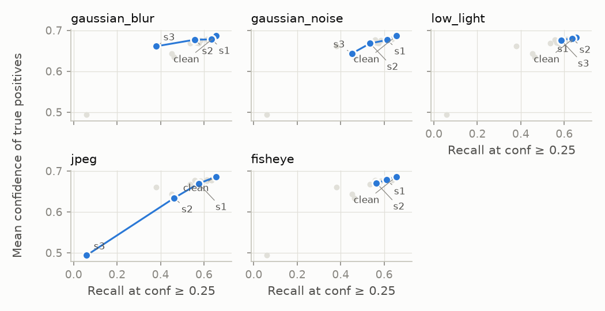
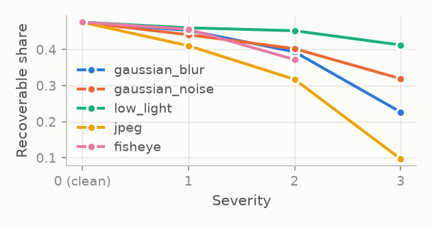

# Does a Person Detector Know What It Misses? A Preliminary Study of Confidence Reliability under Corruptions, Fisheye Distortion and Adversarial Attacks

**Ashwin Lakshminarasimhan**, VIT Vellore

**Preliminary results** · 2026-11-03 · all numbers produced by the code and data of commit `8ad4f20`

## Abstract

In headcounts and surveillance, a person the detector misses is often the costly error. We ask whether a detector's confidence reveals such misses. We evaluate YOLO11n (CPU, person class only) on 500 COCO val2017 images under 14 synthetic shifts, including a synthetic equidistant fisheye, and on 100 images under a white-box PGD attack with a random-noise control. Under shift, recall at confidence ≥ 0.25 falls from 0.656 to as low as 0.059, while precision stays between 0.747 and 0.873. The detector is underconfident in all 15 clean and shifted conditions; per-detection calibration metrics cannot account for the missed people, because a missed person produces no detection to evaluate. The share of misses recoverable at confidence ≥ 0.05 falls from 0.476 to 0.097. PGD with ε = 4/255 removes all person detections in 96/96 images, random noise of size 8/255 in 0/96. Main limitations: one small model, few images, synthetic fisheye and a non-adaptive attacker.

## 1 Introduction

People counting, occupancy monitoring and surveillance rely on person detectors. In these uses a missed person (a false negative) is often the costly error: a headcount comes out too low, or a person in a restricted area goes unreported. A detector's confidence score is the usual signal of how far to trust its output, and calibration studies ask whether the confidence of an emitted box matches its probability of being correct. A missed person, however, produces no box and therefore no confidence.

This report asks: when the input to a person detector degrades, through common corruptions, fisheye-like lens distortion or adversarial perturbation, do its confidence scores, or simple test-time signals derived from them, indicate that people are being missed? We study this for one small detector (YOLO11n) on COCO person images. The results are preliminary and are meant to decide where a fuller study should focus.

## 2 Related work

Michaelis et al. [1] showed that object detectors lose substantial accuracy under common image corruptions; our shift conditions follow the same idea with a small set of corruptions. Calibration of detectors is commonly measured with the detection expected calibration error (D-ECE) of Küppers et al. [2], which we use, and Huseljic et al. [3] systematically evaluated uncertainty calibration in pretrained detectors. Park et al. [4] point out that per-prediction calibration does not account for missed objects and study image-level uncertainty for detection transformers; our first finding is an empirical demonstration of this point for a YOLO detector under distribution shift, not a new observation.

Adversarial attacks on person detection are well established: Thys et al. [5] hid persons from a detector with printed adversarial patches. We use projected gradient descent (PGD) [6] in the digital domain. Nesti et al. [7] detect adversarial examples through input transformations, defense perturbations and voting; our fifth finding is consistent with this known effect. Athalye et al. [8] showed that attacks optimised over a distribution of transformations (EOT) stay effective under such transformations, so an adaptive attacker would likely defeat the signals tested here. For wide-angle imagery, Zhang et al. [9] craft distortion-aware adversarial perturbations for 360° images from perspective views, and Duan et al. [10] address rotation-aware people detection in real overhead fisheye images.

## 3 Method

**Model and data.** YOLO11n, input size 640, CPU only, seed 0. The data are the first 500 COCO val2017 images (by image id) that contain at least one non-crowd person (2042 non-crowd person boxes); only the person class is evaluated. Predictions are kept down to confidence 0.001 for mAP; all other metrics use detections with confidence ≥ 0.25 unless stated.

**Shift conditions (14).** Gaussian blur (σ = 1, 2, 4 px), additive Gaussian noise (std 0.04, 0.08, 0.12 on [0, 1], seeded per image), low light (intensity × 0.5, 0.3, 0.15), JPEG re-encoding (quality 30, 15, 5) and a synthetic equidistant fisheye whose image half-diagonal maps to 60, 80° (s1, s2). For fisheye, ground-truth boxes are warped with the forward mapping (20 points per edge, then the bounding box, clipped); 36 (s1) and 45 (s2) of 2090 person boxes become smaller than 4 px and are dropped.

**Attack.** On the first 100 images (466 non-crowd persons), a white-box PGD "vanishing" attack [6] perturbs the image at its original resolution and minimises the sum of the top-100 person scores over all predictions: 20 sign-gradient steps of 1/255, ε = 4/255 or 8/255, no random start, keeping the iterate with the lowest loss. The letterbox resize and padding are differentiable and reproduce ultralytics' rectangular letterbox. Attacked images are rounded to 8 bits, saved as PNG and evaluated through the normal pipeline. Control: uniform noise in ±8/255 (rand_eps8). Reference: the same 100 clean images (clean_100).

**Matching.** Detections are matched greedily in descending confidence to non-crowd person boxes at IoU ≥ 0.5. An unmatched detection that overlaps a crowd box by at least half of its own area is ignored (COCO crowd rule).

**Metrics.**

- mAP50, mAP50–95: pycocotools COCOeval, person class only.
- Recall at threshold t: matched non-crowd persons / all non-crowd persons, with detections of confidence ≥ t (t = 0.05, 0.10, 0.25).
- Precision at t: TP / (TP + FP); ignored detections are excluded.
- D-ECE [2]: Σ (n_bin / N) · |mean confidence − precision| over 10 equal-width confidence bins.
- Signed calibration gap: Σ (n_bin / N) · (precision − mean confidence) over the same bins; positive means underconfident.
- Recoverable share: (recall at 0.05 − recall at 0.25) / (1 − recall at 0.25), the share of persons missed at 0.25 that are found at 0.05.
- AUROC: separability of true from false positives (box level), of images that miss at least half of their persons (image level), or of attacked from non-attacked images.
- Risk-coverage: false-positive fraction among the detections kept when ranking by a score.
- View signals: consistency = mean over two views (horizontal flip, input size 576) of a detection's best IoU with a detection in that view; view disagreement = mean relative change in the number of detections across views.

**Audit.** The code was checked by an independent second agent; every issue found and its fix are recorded in RESEARCH_LOG.md.

## 4 Results

**Table 1.** Key conditions. Recall, precision and mean true-positive confidence at confidence ≥ 0.25. "Signed gap" equals D-ECE wherever defined, because no bin is overconfident. "–" = undefined (no detections at confidence ≥ 0.25). The first seven rows use 500 images, the last four the first 100.

| Condition | Images | mAP50 | Recall | Precision | Mean TP conf. | Signed gap | Recov. share |
|---|---|---|---|---|---|---|---|
| clean | 500 | 0.780 | 0.656 | 0.854 | 0.686 | 0.208 | 0.476 |
| gaussian_blur_s3 | 500 | 0.505 | 0.380 | 0.837 | 0.661 | 0.217 | 0.227 |
| gaussian_noise_s3 | 500 | 0.598 | 0.452 | 0.843 | 0.643 | 0.239 | 0.319 |
| low_light_s3 | 500 | 0.738 | 0.585 | 0.872 | 0.676 | 0.230 | 0.413 |
| jpeg_s3 | 500 | 0.135 | 0.059 | 0.747 | 0.494 | 0.289 | 0.097 |
| fisheye_s1 | 500 | 0.757 | 0.612 | 0.858 | 0.678 | 0.220 | 0.456 |
| fisheye_s2 | 500 | 0.708 | 0.564 | 0.857 | 0.670 | 0.225 | 0.372 |
| clean_100 | 100 | 0.794 | 0.663 | 0.866 | 0.684 | 0.220 | 0.446 |
| rand_eps8 | 100 | 0.783 | 0.661 | 0.883 | 0.674 | 0.236 | 0.418 |
| pgd_eps4 | 100 | 0.018 | 0.000 | – | – | – | 0.000 |
| pgd_eps8 | 100 | 0.000 | 0.000 | – | – | – | 0.000 |

**F1 Silent omission under natural shift.** Across the 14 shift conditions, recall at 0.25 ranges from 0.059 (jpeg_s3) to 0.654 (low_light_s1), compared with 0.656 on clean images, while precision stays between 0.747 and 0.873 (clean 0.854). The mean confidence of true positives stays between 0.634 and 0.682 (clean 0.686) in all conditions except jpeg_s3 (0.494) (Figure 1). The signed calibration gap is positive in all 15 clean and shifted conditions (0.208 to 0.289), and none of their 119 populated confidence bins is overconfident. The boxes that are emitted are at least as reliable as their confidence suggests, while a growing share of persons is not reported at all. Per-detection calibration cannot reveal this, as Park et al. [4] noted.

*Figure 1. Recall at confidence ≥ 0.25 against the mean confidence of true positives, one panel per corruption family (clean → s1 → s2 → s3; grey: all other conditions).*

**F2 Fewer misses are recoverable as severity grows.** On clean images, 0.476 of the persons missed at 0.25 are found at 0.05, at a precision of 0.515 (vs 0.854 at 0.25). In all 5 families this share decreases at every severity step (Figure 2), down to 0.227 (blur s3), 0.319 (noise s3), 0.413 (low light s3), 0.097 (JPEG s3) and 0.372 (fisheye s2). Under strong shift, missed persons are increasingly absent from the low-confidence detections as well, so lowering the threshold recovers fewer of them.

*Figure 2. Recoverable share against severity (clean = 0), one line per corruption family.*

**F3 View consistency does not beat confidence under natural shift.** For separating true from false positives, confidence reaches AUROC 0.823 to 0.865 and view consistency 0.728 to 0.793 in the 14 of 15 clean and shifted conditions where confidence is better. Consistency is higher only for jpeg_s3 (0.776 vs 0.726). At image level (pooled over 7,498 condition-image observations from 500 source images; descriptive only), mean confidence is more strongly associated with the miss rate (Spearman -0.706) than view disagreement is (0.245).

**F4 PGD suppresses all person detections at confidence ≥ 0.25 on the 100-image subset; random noise of equal size does not.** With ε = 4/255, all 96 of the 96 images that had at least one person detection at 0.25 lose all of them (mean persons per image 3.95 → 0.00); ε = 8/255 gives 96/96. Uniform noise of size 8/255 removes all persons in 0/96 images (3.95 → 3.87 persons per image), and mAP50 moves from 0.794 to 0.783, compared with 0.018 (ε = 4/255) and 0.000 (ε = 8/255) under PGD. The effect comes from the optimised direction of the perturbation, not from its size.

**F5 Against this non-adaptive attacker, simple views partly undo the attack.** On PGD images, recall at 0.25 is 0 in the original view, but 0.494 with a horizontal flip and 0.481 at input size 576 for ε = 4/255 (0.356 and 0.408 for ε = 8/255), against 0.663 on the clean images. View disagreement separates pgd_eps8 images from clean images with AUROC 0.835 and from random-noise images with 0.831. This is consistent with the known effect used for detection by input transformations [7]. The attack was not optimised over these views, and an adaptive EOT attack [8] would likely remove the effect. Mean confidence separates attacked from clean images almost perfectly (raw AUROC 0.020, 0.980 with the sign flipped) only because attacked images have no detections; it flags any image without confident detections in the same way.

## 5 Limitations

- One small model (YOLO11n) and only the person class; larger models or other detector families may behave differently.
- 500 images (100 for the attack) and no confidence intervals, so small differences between conditions should not be over-interpreted.
- The fisheye is synthetic, and warped ground-truth boxes are bounding boxes of warped rectangles, looser than boxes drawn on real fisheye images. The drop in mAP50–95 (ratio mAP50–95 / mAP50: 0.684 on clean images, 0.597 for fisheye_s2) may partly reflect these looser warped ground-truth boxes, but this study does not separate that effect from distorted appearance or detector localization.
- The attack is white-box, digital (not a physical patch) and not adaptive to the view transformations.
- At low thresholds many boxes are emitted (precision 0.515 at 0.05 on clean images), so some matches at IoU ≥ 0.5 may be chance overlaps; recall at 0.05 and the recoverable share may be overestimated for this reason.
- Pooled image-level statistics combine 15 conditions of the same 500 images and are descriptive only; no p-values are reported for them.

## 6 Next steps

- Position-dependent adversarial vulnerability under fisheye geometry: place the same person at the image centre and at the edge, and measure the minimal attack strength that removes the detection.
- An adaptive EOT attack [8] against the flip and rescale signals.
- Larger YOLO models and at least one non-YOLO detector.
- Real overhead fisheye data, for example the datasets used with RAPiD [10].

## 7 Reproducibility

Code, all result CSVs and the prediction caches are in a local git repository (results frozen at commit `8ad4f20`). `reproduce.bat` (Windows) and `reproduce.sh` run all stages and rebuild `results/summary.md`; rerunning them from the caches reproduced all 100 result CSVs byte-identically. `RESEARCH_LOG.md` records every problem, fix and design decision. CPU runtimes as measured on the machine that produced the results (from the README):

| Stage | Full | From cache |
|---|---|---|
| baseline (500 images) | 66 s (+ ~640 s one-off image download, 1.3 s/image) | 9 s |
| shift (14 conditions × 500) | 859 s | 98 s |
| reliability (15 conditions × 2 views × 500) | 2179 s | 119 s |
| attack (100 images; PGD generation ≈ 500 s per eps) | 1162 s | 8 s |
| `--stage attack --gradcheck 5` | 63 s | n/a |
| `reproduce.sh`, all stages + summary | ≈ 4,270 s (≈ 71 min, excl. download) | 290 s |

## Acknowledgements

Code for this study was written with the assistance of AI coding tools (Claude Code and OpenAI Codex). All design decisions, analyses and conclusions are the author's; every result was independently re-audited, and all problems found are documented in RESEARCH_LOG.md.

## References

[1] Michaelis et al. Benchmarking Robustness in Object Detection: Autonomous Driving when Winter is Coming. arXiv:1907.07484, 2019.

[2] Küppers et al. Multivariate Confidence Calibration for Object Detection. CVPR Workshops, 2020.

[3] Huseljic et al. Systematic Evaluation of Uncertainty Calibration in Pretrained Object Detectors. International Journal of Computer Vision, vol. 133, pp. 1033–1047, 2025.

[4] Park, Sobolewski, Azizan. Quantifying the Reliability of Predictions in Detection Transformers: Object-Level Calibration and Image-Level Uncertainty. arXiv:2412.01782v3, 2024.

[5] Thys et al. Fooling Automated Surveillance Cameras: Adversarial Patches to Attack Person Detection. CVPR Workshops, 2019.

[6] Madry et al. Towards Deep Learning Models Resistant to Adversarial Attacks. ICLR, 2018.

[7] Nesti et al. Detecting Adversarial Examples by Input Transformations, Defense Perturbations, and Voting. arXiv:2101.11466, 2021.

[8] Athalye et al. Synthesizing Robust Adversarial Examples. ICML, 2018.

[9] Zhang et al. 360-Attack: Distortion-Aware Perturbations from Perspective-Views. CVPR, 2022.

[10] Duan et al. RAPiD: Rotation-Aware People Detection in Overhead Fisheye Images. CVPR Workshops, 2020.
